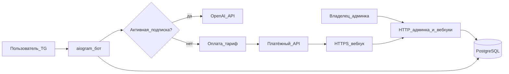
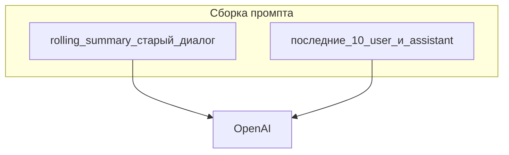

# План: Telegram-бот + ChatGPT + платная подписка (Python, РФ-платежи)

> Снимок плана на хранение в репозитории. Исходник в Cursor: `.cursor/plans/telegram_gpt_подписка_63eb0cb0.plan.md`.

## Контекст

- Репозиторий `c:\dev\tg_tutor` — реализация с нуля.
- Выбрано: **Python** и **локальные РФ/СНГ-провайдеры** (ЮKassa, Robokassa, CloudPayments и т.д.).
- **БД**: **PostgreSQL** (отдельный сервис или managed-инстанс), драйвер `asyncpg` + SQLAlchemy 2 async.
- **Хостинг продакшена**: **VPS + Docker** (контейнеры для приложения и PostgreSQL, при необходимости отдельный контейнер или хостовый reverse proxy для HTTPS — см. ниже).

## Рекомендуемая архитектура (MVP)



### Память диалога

- **Последние 10 сообщений пользователя** — в контексте модели передаются **полностью** (текст как в Telegram). Чтобы диалог не терял смысл, к ним добавляются **ответы ассистента**, относящиеся к этим же ходам (последние **10 пар** «user → assistant» или эквивалентно: 10 реплик `user` + соответствующие `assistant` подряд).
- **Всё, что старше этого окна**, не хранится в сыром виде в промпте: периодически **сжимается в одно резюме** (отдельный вызов к той же или лёгкой модели: «кратко сохрани факты и договорённости из диалога»). В запрос к ChatGPT уходит: сообщение `system` или префикс с резюме + **ролевые сообщения** для последних 10 user-сообщений и их ответов.
- Реализация: таблица сообщений в PostgreSQL + поле `conversation_summary` (текст) на пользователя; при появлении 11-го user-сообщения — сдвиг окна: самые старые пары из «хвоста» **добавить в summary** (merge с предыдущим резюме), удалить или пометить архивными сырые строки за пределами окна.



- Порог **10** вынести в конфиг (`RECENT_USER_MESSAGES=10`), чтобы менять без правок кода.
- **Сброс памяти**: команда (например **`/reset`** или **`/newchat`**) — удаляет у пользователя **все** строки из `chat_messages`, обнуляет `conversation_summary`; диалог с моделью начинается **с нуля**. Запись в `users` и **подписка** не удаляются. Ответ пользователю: короткое подтверждение («Память очищена»). Опционально позже: подтверждение через inline-кнопку, если понадобится защита от случайного сброса.
- **Бот (aiogram 3.x)**: команды `/start`, `/status`, `/subscribe`, обработка текстовых сообщений (и при необходимости голос/фото — отдельным этапом), плюс команда сброса памяти выше.
- **Доступ к модели**: перед вызовом OpenAI проверять в БД, что у `telegram_id` есть активная подписка и не исчерпаны **лимиты тарифа** (см. таблицу `plans` и учёт использования за период). Идентификатор модели (`gpt-4.1-mini`, `gpt-5.x`, …) берётся из **тарифа**, к которому привязана подписка, а не из жёстко прошитого конфига — чтобы менять поведение через админ-зону.
- **Оплата**: для MVP проще всего **разовая покупка периода** (например, 30 дней) через **платёжную ссылку/виджет** провайдера, подтверждение по **вебхуку** на ваш HTTPS-эндпоинт. Полноценные **рекуррентные списания** (автопродление) — отдельная фаза: у каждого провайдера свои требования и согласования.
- **Первый провайдер в коде**: разумный дефолт — **ЮKassa** (документация, тестовый контур, типичный сценарий «создать платёж → redirect/кнопка → `payment.succeeded`»). Слой абстракции `PaymentProvider` позволит позже добавить Robokassa/CloudPayments без переписывания бота.

## Стек и зависимости

- **Telegram**: `aiogram` 3.x.
- **OpenAI**: официальный SDK `openai` (Chat Completions / Responses — по актуальной API).
- **БД**: **PostgreSQL** + `asyncpg` + SQLAlchemy 2 async; для продакшена и нагрузочных вебхуков — отдельный сервер; локально — Docker или локальный Postgres.
- **HTTP (вебхуки и админка)**: **FastAPI** (или Starlette) — маршрут вебхука ЮKassa, **админ-зона** (тарифы, лимиты, модель LLM), единая точка HTTPS за reverse proxy.
- **Конфиг**: `pydantic-settings`, `.env`.
- **Деплой**: **VPS + Docker** — `docker-compose` (Postgres, бот, HTTP-сервис с админкой и вебхуками); на хосте **Caddy/nginx** с TLS и прокси на контейнер.

## Модель данных (минимум)

- `users`: `telegram_id`, метаданные (username, locale), `created_at`, опционально `conversation_summary` (текст накопленного резюме старой истории).
- `chat_messages`: `user_id`, `role` (`user` | `assistant`), `content`, `created_at`, индекс по `(user_id, created_at)` для выборки последних сообщений и сдвига окна.
- **`plans` (тарифы)** — редактируются только через **админ-зону**: человекочитаемое имя, `price`, `currency`, длительность подписки в днях (`duration_days`), **лимиты** (например `max_requests_per_day` и/или `max_requests_per_period`, либо одно поле «запросов за период подписки» — зафиксировать в миграции), **`openai_model`** (строка ID модели для Chat Completions / Responses API), флаг `is_active`, порядок сортировки для бота (`/subscribe`).
- `subscriptions`: `user_id`, **`plan_id`** (FK на `plans`), `starts_at`, `ends_at`, `status` (`active`/`expired`). Снимок цены на момент оплаты при необходимости — в `payments` или денормализованное поле.
- **Учёт лимитов**: отдельная таблица `usage_counters` (например `user_id`, `period_start`, `requests_count`) или агрегация по `chat_messages` за сутки/период — на усмотрение реализации; middleware бота перед вызовом OpenAI сверяет счётчик с лимитом активного тарифа.
- `payments`: `provider`, `provider_payment_id`, `amount`, `currency`, `status`, `raw_payload` (JSON для разбора споров), связь с `user_id`, опционально `plan_id`.

Идемпотентность: обработка вебхука по `provider_payment_id`, чтобы не продлевать подписку дважды.

## Админ-зона

- **Назначение**: вы (владелец продукта) без деплоя правите **тарифы**: цена, период действия подписки после оплаты, **лимиты запросов**, **модель OpenAI** для пользователей на этом тарифе.
- **Реализация**: веб-интерфейс на том же FastAPI (или минимальные HTML-формы + POST), CRUD по `plans`; список активных тарифов подтягивает бот в `/subscribe`.
- **Доступ**: не публичный — пароль/сессия + `SECRET_KEY`, опционально **белый список IP**, Basic Auth за reverse proxy, или отдельный порт только из VPN; в `.env` — `ADMIN_USERNAME` / `ADMIN_PASSWORD_HASH` (или OIDC позже).
- **Не путать** с «личным кабинетом пользователя» вне Telegram: админка — только для оператора/владельца.

## Поток оплаты (MVP)

1. Пользователь выбирает тариф → бот создаёт платёж через API ЮKassa с `return_url` и **metadata**: `telegram_id`, `plan_id`.
2. Бот отправляет **кнопку-ссылку** на оплату (или инструкцию).
3. ЮKassa шлёт HTTP-уведомление на ваш `/webhooks/yookassa` → проверка подписи/секрета → при успехе: создать/продлить `subscriptions.ends_at`.

## Безопасность и эксплуатация

- Секреты только в переменных окружения: `BOT_TOKEN`, `OPENAI_API_KEY`, ключи ЮKassa, `WEBHOOK_SECRET`/проверка IP whitelist по [документации провайдера](https://yookassa.ru/developers/using-api/webhooks).
- Публичный **HTTPS** URL для вебхуков и админки: на **VPS** — reverse proxy (Caddy/nginx) с TLS-сертификатом, прокси на Docker-порт сервиса с FastAPI. Для локальной разработки — **ngrok** / Cloudflare Tunnel.
- Лимиты OpenAI: таймауты, ретраи с backoff; **дополнительно** лимит длины `conversation_summary` и размера одного сообщения; при сбое summarization — безопасный fallback (обрезка или повтор попытки), опционально rate limit на пользователя.

## Структура каталогов (предлагаемая)

```text
tg_tutor/
  app/
    bot/          # handlers, middleware подписки и лимитов
    services/     # openai.py, conversation_memory.py, payments/
    db/           # models, session, migrations
    web/          # FastAPI: webhooks, админ-зона (тарифы, лимиты, модель)
  alembic/        # миграции
  docker-compose.yml  # Postgres + бот + HTTP (единый compose для VPS)
  Dockerfile
  .env.example
  README.md       # VPS + Docker, токены, тестовый контур ЮKassa, ngrok
```

## Деплой: VPS и Docker

- Один **VPS**; на хосте установлены Docker и Docker Compose.
- **`docker-compose.yml`**: сервис PostgreSQL (volume для данных), сервис приложения (бот + FastAPI в одном процессе через `asyncio` или два процесса в одном образе — на усмотрение), переменные окружения из `.env` на сервере (не коммитить).
- **HTTPS**: терминация TLS на хосте (Caddy с автоматическим Let’s Encrypt) или nginx → `proxy_pass` на `127.0.0.1:<порт_контейнера>`. Вебхук ЮKassa и админка — один базовый URL.
- **Бэкапы**: регулярный снимок volume Postgres и/или `pg_dump` по cron на VPS.

## Верификация после реализации

- Линтер/типы по изменённым файлам.
- Смоук: запуск бота в polling, тестовый платёж в sandbox ЮKassa, срабатывание вебхука (через tunnel), проверка `/status` в боте.
- Ручной сценарий: пользователь без подписки → видит оффер → после «оплаты» в тесте получает ответы от модели.
- Админ-зона: создание/редактирование тарифа с лимитом и моделью → бот использует новые значения; превышение лимита → отказ с понятным сообщением.
- Память: после **11+** user-сообщений бот сохраняет контекст (summary + последние 10); проверить, что факты из начала диалога кратко присутствуют в ответах.
- Сброс: команда **`/reset`** (или выбранное имя) — в БД нет сообщений и пустой summary; следующий ответ бота не опирается на старый диалог.

## Что сознательно вне MVP

- Рекуррентные платежи и привязка карты.
- Полноценный **личный кабинет пользователя** вне Telegram (не путать с админ-зоной владельца).
- Мультиязычность UI (можно заложить i18n позже).

## Риски

- **Законодательство и оферта**: текст подписки, оферта, обработка ПДн — на стороне владельца продукта (в коде — только техническая часть).
- **Надёжность вебхуков**: очередь/повторная обработка при сбоях — усиление после MVP.
- **Эксплуатация Postgres**: бэкапы, миграции при деплое, мониторинг диска и соединений.
- **Админ-доступ**: компрометация учётки админки даёт контроль над тарифами — сильные пароли, 2FA на прокси при возможности, не выставлять админку в открытый интернет без защиты.
